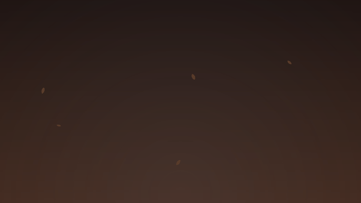

<div align="center">

# Seasonfall

**Сезонные живые обои для niri и Wayland**

Осенью падают листья, весной летят лепестки, летом кружится тополиный пух,
зимой искрится иней. А дождь и снег появляются только тогда, когда они
действительно идут в Москве.


[](https://github.com/MrSpacc/seasonfall)

[Возможности](#возможности) · [Установка](#установка) · [Запуск](#запуск) ·
[Настройка](#настройка) · [Как это устроено](#как-это-устроено) ·
[Решение проблем](#решение-проблем)

</div>

<p align="center">
  
  <br>
  <sub>Демонстрация рендера. Фон — условный градиент, а не реальные обои.</sub>
</p>

## Возможности

- **Четыре сезона** — листья, лепестки, тополиный пух и иней меняются по
  календарю.
- **Настоящая погода** — дождь и снег включаются только при фактических
  осадках в Москве, а не по прогнозу и не по одному `weather_code`.
- **Не мешает работе** — окно лежит на слое `bottom`, клики и прокрутка
  проходят сквозь него.
- **Несколько мониторов** — своё окно на каждый экран; при подключении или
  отключении монитора окна пересоздаются автоматически.
- **Экономично** — перерисовываются только области с частицами, медленные
  эффекты рисуются в 15 fps.
- **Плавные переходы** — смена эффекта идёт через кроссфейд; ночью частицы
  приглушаются, при грозе сверкают молнии.
- **Работает без интернета** — последние данные погоды кэшируются, при
  недоступной сети остаётся сезонный эффект.
- **Превью без Wayland** — можно сохранить PNG или GIF и посмотреть, как всё
  выглядит, не запуская обои.

## Требования

| Компонент | Версия |
|-----------|--------|
| Wayland-композитор | с поддержкой `wlr-layer-shell` (проверено на niri 26.04) |
| Python | 3.11+ |
| GTK | 3.24+ |
| Библиотеки | `gtk-layer-shell`, PyGObject, pycairo, Pillow |

Нужен **системный** Python: PyGObject и GTK должны быть доступны как модули
`gi` и `cairo`.

## Установка

Arch Linux и производные:

```sh
sudo pacman -S gtk3 gtk-layer-shell python-gobject python-cairo python-pillow
```

Склонируйте репозиторий и перейдите в его каталог:

```sh
git clone https://github.com/MrSpacc/seasonfall.git
cd seasonfall
```

Если файла `config.toml` ещё нет, создайте его из примера:

```sh
cp config.example.toml config.toml
```

Проверьте, что системный Python видит GTK:

```sh
/usr/bin/python3 -c "import gi, cairo; print('ok')"
```

## Запуск

```sh
./seasonfall-run
```

`seasonfall-run` намеренно запускает `/usr/bin/python3`. Если в `PATH` стоит
другой Python (например, venv без PyGObject), обычный `python3 main.py`
упадёт с ошибкой импорта `gi`. Старое имя `snow-run` оставлено как обёртка
над этим же лаунчером.

Остановка — `Ctrl+C` или `SIGTERM`. Второй экземпляр не запустится: его
остановит lock-файл `~/.cache/seasonfall/seasonfall.lock`.

### Команды

| Команда | Что делает |
|---------|------------|
| `./seasonfall-run` | запускает анимацию |
| `./seasonfall-run --weather` | показывает погоду и текущий сезон |
| `./seasonfall-run --preview preview.png` | сохраняет статичный кадр |
| `./seasonfall-run --preview preview.gif` | сохраняет анимированный предпросмотр |
| `./seasonfall-run --effect rain` | принудительный эффект (для проверки) |
| `./seasonfall-run --season winter` | принудительный сезон |
| `./seasonfall-run --fps 20` | снижает нагрузку на CPU |
| `./seasonfall-run --offline` | не обращается к сети (для превью) |
| `./seasonfall-run --config path.toml` | берёт другой конфиг |
| `./seasonfall-run --debug` | подробный лог |
| `./seasonfall-run --version` | версия |

Доступные эффекты: `auto`, `rain`, `snow`, `leaves`, `petals`, `fluff`,
`frost`, `none`.

## Автозапуск в niri

Добавьте в `~/.config/niri/config.kdl` абсолютный путь к лаунчеру:

```kdl
spawn-at-startup "/home/you/Code/seasonfall/seasonfall-run"
```

Замените путь на свой. После следующего входа анимация появится сама.

## Как выбирается эффект

| Месяцы | Сезон | Обычный эффект |
|--------|-------|----------------|
| декабрь–февраль | зима | иней |
| март–май | весна | лепестки |
| июнь–август | лето | тополиный пух |
| сентябрь–ноябрь | осень | листья |

Приоритет:

1. Если в Москве идёт дождь — рисуется дождь.
2. Если идёт снег — рисуется снег.
3. Иначе — сезонный эффект.

«Идёт» определяется по фактическим осадкам: `snowfall > 0.01 см` — снег,
`precipitation > 0.02 мм` — дождь (порог настраивается). `weather_code`
используется только как уточнение. Поэтому ситуация «код 71, но осадков
0.00 мм» честно считается сухой.

## Настройка

По умолчанию читается **`config.toml` в корне проекта**, рядом с `main.py`.
Если файла нет, работают значения по умолчанию. Другой путь можно указать
флагом `--config`.

Скопируйте пример и отредактируйте:

```sh
cp config.example.toml config.toml
```

Основные секции:

- `[location]` — координаты и часовой пояс (по умолчанию Москва).
- `[weather]` — частота обновления, порог осадков, таймаут, срок жизни кэша.
- `[effects]` — включение отдельных эффектов, молнии и цветовая дымка.
- `[render]` — `fps`, `density`, `night_dim`, `seed`.

Неизвестные параметры и неверные значения дают понятную ошибку при старте,
а не тихо игнорируются.

## Производительность

Замеры на двух мониторах (1920×1080 и 2560×1440), `fps = 30`, одно ядро из 12:

| Эффект | CPU |
|--------|-----|
| листья (медленный режим, 15 fps) | ~31 % |
| дождь | ~59 % |
| снег | ~57 % |

Основная нагрузка — композиция прозрачного слоя на весь экран, а не расчёт
частиц (доли миллисекунды на кадр). Если хочется тише, поставьте `fps = 20`:
для сезонных эффектов разница почти незаметна.

## Как это устроено

| Файл | Назначение |
|------|------------|
| `main.py` | CLI, блокировка, поток погоды, таймер анимации |
| `window.py` | прозрачные окна на слое `bottom`, click-through, мониторы |
| `scene.py` | выбор эффекта, кроссфейд, ночное приглушение, молнии |
| `effects.py` | частицы: дождь, снег, листья, лепестки, пух, иней |
| `weather.py` | Open-Meteo без ключа, классификация осадков, кэш |
| `seasons.py` | сезон по календарю и русские подписи |
| `config.py` | чтение и валидация TOML |
| `preview.py` | рендер PNG/GIF без Wayland |
| `test_snow.py` | тесты |
| `seasonfall-run` | запуск через системный Python |

Окно создаётся через `gtk-layer-shell` на слое `bottom`: оно выше обоев, но
ниже обычных окон. Input region пустой, поэтому мышь и клавиатура работают с
приложениями под анимацией. Погода обновляется в фоновом потоке раз в
10 минут; при недоступной сети показываются последние данные из кэша
`~/.cache/seasonfall/weather.json` (до 3 часов).

## Тесты

```sh
/usr/bin/python3 -m unittest test_snow -v
```

34 теста покрывают сезоны, классификацию осадков, выбор эффекта, парсинг
Open-Meteo, конфиг, кэш, блокировку запуска, ресайз сцены и рендер PNG/GIF.

Быстрая проверка без окон:

```sh
./seasonfall-run --preview /tmp/seasonfall.png --width 960 --height 540
```

## Решение проблем

**`ModuleNotFoundError: gi`**

Запускайте через `./seasonfall-run` или `/usr/bin/python3 main.py`, а не через
`python3` из venv.

**Анимации не видно**

Проверьте, что слой создан:

```sh
niri msg layers
```

В `Bottom layer` должна быть строка `Namespace: "seasonfall"`. Слой находится
над обоями, но под обычными окнами. Порядок с виджетами рабочего стола
зависит от композитора.

**Дождь не идёт, хотя «по прогнозу» должен**

```sh
./seasonfall-run --weather
```

Покажет фактические осадки. Если `precipitation = 0.00`, дождя нет — это
задумано.

**Высокий CPU**

Уменьшите `fps` (например, до 20) или `density` в `config.toml`. Дождь и снег
рисуются на полной частоте, сезонные эффекты — в 15 fps.

**Конфиг не применяется**

Убедитесь, что файл лежит в корне проекта и называется `config.toml`, либо
передайте путь явно: `./seasonfall-run --config /path/to/config.toml`. При
`--debug` в логе будет строка `Конфиг: ...`.

**После смены мониторов**

Окна пересоздаются автоматически. Если композитор не прислал событие,
перезапустите `seasonfall-run`.

---

Погодные данные — [Open-Meteo](https://open-meteo.com/), без API-ключа.
